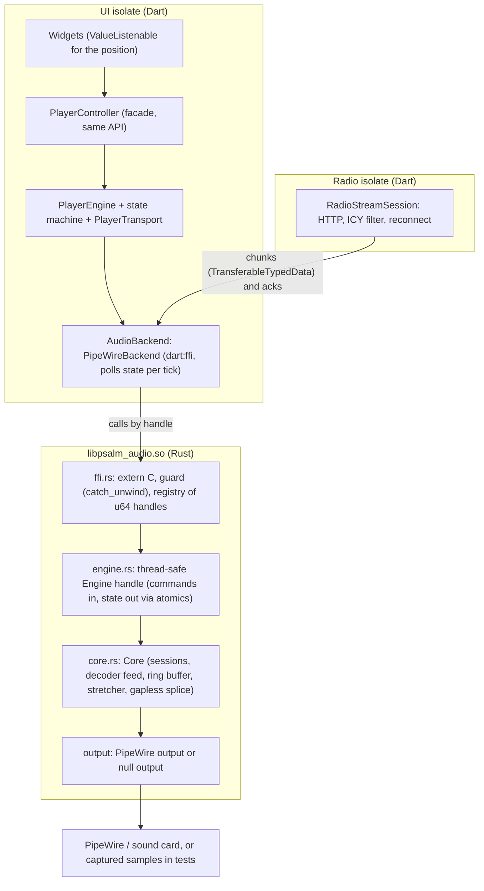
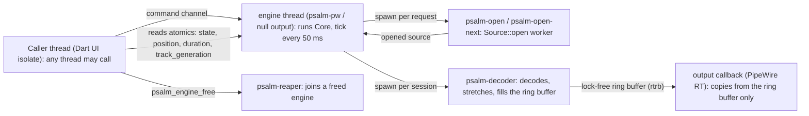
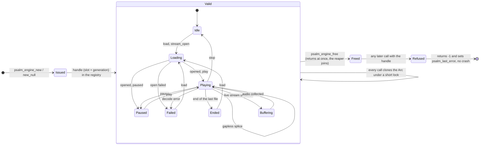
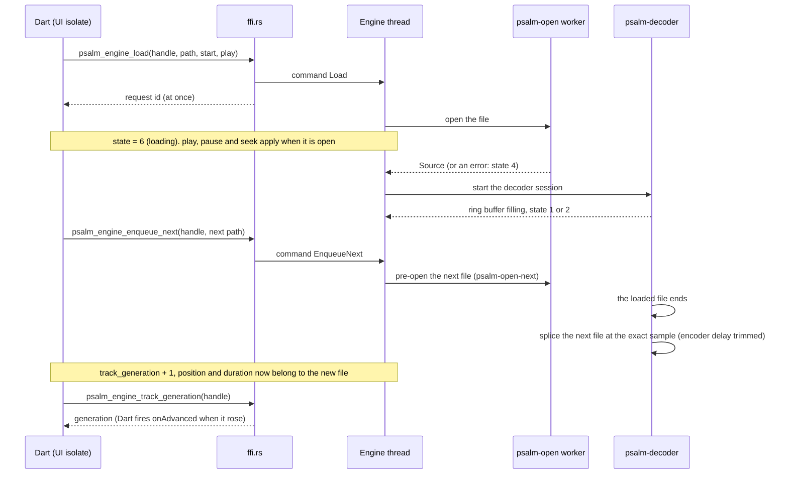

<!-- SPDX-FileCopyrightText: 2026 Joerg Bernau <Joerg@bernau.family> -->
<!-- SPDX-License-Identifier: AGPL-3.0-or-later -->
# The FFI architecture of the audio engine

Status 2026-10-30. This is the reference for the interface between the Dart app and the native engine (`audio/`, Rust, built as `libpsalm_audio`). It describes
what is built since the rebuild P3 (`docs/spec-engine-rebuild.md`). The C header is `audio/include/psalm_audio.h` (the contract), the Rust side is
`audio/src/ffi.rs` (+ `engine.rs`, `core.rs`, `output/`), the Dart side is `app/lib/audio/pipewire_backend.dart`. Also see `docs/spec-audio-pipewire.md` (design of the
engine) and `docs/spec-player-state-machine.md` (the player that uses it).

## 1. The layers

The rule that shapes everything: **the UI isolate never waits for the engine.** Commands return at once, state is read from atomics, and the work (opening files, decoding,
network) happens on other threads. The only thing the UI isolate does for the radio is to push bytes it received from the radio isolate.

## 2. Threads

- The **output callback** (real-time) allocates nothing, takes no lock and touches no file: it copies from the ring buffer.
- A **decoder thread** belongs to one *session* (one loaded file); a winding-down decoder has its own `Track` data and cannot disturb the next session.
- **Open workers** exist only while a file is being opened. A hung file (a dead network mount) costs one worker, never the caller.
- Lock order: the registry mutex is held only briefly (to clone an `Arc`), never during a blocking call. The output callback takes no locks.

## 3. The contract (what C, Rust and Dart agree on)

**Handles.** An engine is an opaque `uint64_t` (`PsalmHandle`): slot and generation in a global registry of `Arc<Engine>`. `0` is never valid. A handle that is `0`, never issued,
already freed or from a reused slot is **refused**: the call returns its failure value (`-1`, or `0` for creation) and sets a reason. It never crashes, and any thread may call any
function, also while another thread frees (a call holds its own `Arc`).

**State codes** (`psalm_engine_state`): `0` idle, `1` playing, `2` paused, `3` ended, `4` failed, `5` buffering (live stream), `6` loading (a file is being opened), `-1` invalid handle. The
Dart `BackendState` has no "loading": while the engine says `6`, `PipeWireBackend` reports the state the caller asked for, so the player machine is unchanged.

**Errors.** Every function returns `0` on success and `-1` on failure unless said otherwise. The reason of a failed call on a valid handle is `psalm_engine_last_error(handle)`; failures
that belong to no engine (creation, an invalid handle) are in the global `psalm_last_error()`. The reason a *state* is `4` is `psalm_engine_error(handle)`. Strings are UTF-8, zero-terminated,
copied into a caller buffer, the full length is returned (the same convention for all three).

**Panics.** Every `extern "C"` function runs inside `guard` (`catch_unwind`): a Rust panic never unwinds into Dart or C.

**Version.** `psalm_abi_version()` returns `(major << 16) | minor`; `PSALM_API_VERSION` in the header must match. The **major** changes when the interface breaks, the **minor** when something is
added. Dart checks it when it opens the library and refuses a mismatch or a missing symbol with a clear `AudioException`. Version 2.0 broke the interface once (handles instead of pointers).

**Memory.** The caller owns the buffers it passes (`const char *`, `uint8_t *data, len`); the library copies what it keeps. The library owns nothing the caller must free except the handle.

## 4. The calls

| Group | Calls | Notes |
|---|---|---|
| Life | `psalm_engine_new(target)`, `psalm_engine_new_null(speed)`, `psalm_engine_free` | `new` connects to PipeWire (a sink name or NULL). `new_null` = no output (tests): speed 0 as fast as possible, 1 real time, n times real time. `free` does not wait for the audio thread. |
| Playback | `load(path, start_ms, play, media_name)`, `play`, `pause`, `stop`, `seek(ms)`, `set_speed` (0.5-3.0, pitch kept), `set_volume`, `set_buffer(seconds)` | `load` returns a request id at once, a worker opens the file. `set_buffer` (1-30 s, default 2) applies from the next load. |
| Gapless | `enqueue_next(path)`, `clear_next`, `track_generation` | see section 5 |
| State | `state`, `position_ms`, `duration_ms` (-1 unknown), `volume`, `error`, `last_error` | read from atomics, never block |
| Live stream | `stream_open(play, media_name)`, `stream_push(data, len)`, `stream_end`, `stream_fail(message)` | the caller does the networking and pushes plain MP3 bytes; `stream_push` returns the bytes taken (fewer than `len` = queue full, offer the rest later) or -1, never blocks |
| Meta | `psalm_abi_version`, `psalm_last_error` | |

Dart: every function has a native typedef and a Dart typedef in `pipewire_backend.dart` (`lookupFunction`); they must match the header one by one (`Uint64` handle, `Int64` request ids,
`IntPtr` for `size_t`, `Float`, `Int32`). A mismatch is a silent memory error: **change header, Rust and Dart together** (checklist in section 7).

## 5. Load and gapless

- A newer `load` replaces one still being opened. While loading, `position` is `start_ms` and `duration` is -1.
- **Gapless:** `enqueue_next` replaces an earlier queued file, `load` or `stop` drops it. At the end of the loaded file the decoder continues with the queued one **at the exact sample** (no
  silence, no repeated or lost sample, the MP3 encoder delay and padding are trimmed by the decoder), and the state stays `1`. A queued file that cannot be opened, or has another sample rate
  or channel count, is **not** an error: the loaded file ends normally (state `3`) and the player loads the next one the old way.
- `track_generation` counts the switches over the life of the engine (a load, seek or stop does not count). It is incremented under the same lock that yields the new file's data, so a caller
  that reads the generation first and the position second sees the new file. Dart calls `onAdvanced` when the number rose (it polls per tick, 200 ms at most).

## 6. Testing without a sound card

The `Output` trait has a real implementation (`output/pipewire.rs`) and a **null output** (`output/null.rs`), which pulls the same `process` closure at real, accelerated or n-times real time
and collects the samples in memory or in a raw `f32le` file. `cargo test` in `audio/` (61 tests) uses it: sample-exact checks of a sine file, a two-file gapless chain, seek, speed, live-stream back
pressure, load while loading, a hung file, stale and double-freed handles. `app/test/pipewire_null_test.dart` drives the real library through Dart FFI (it finds `libpsalm_audio.so` through
`PSALM_AUDIO_LIB` or `audio/target/{debug,release}/` and skips when it is absent). `audio/scripts/verify*.sh` stay as smoke tests for the PipeWire output (they need PipeWire, a null sink and `ffmpeg`).
What no test can say: whether a seam is audible and how the PipeWire path behaves under real load.

## 7. Adding or changing a function (checklist)

1. Rust: the function in `ffi.rs` inside `guard`, validating the handle and every pointer; a test with the null output (and one for the invalid handle).
2. Header: the declaration with a comment that states the return values and the threads it may be called from; bump `PSALM_API_VERSION` (minor for an addition, major for a break) and `psalm_abi_version`.
3. Dart: native and Dart typedefs and `lookupFunction`; `kPsalmApiMajor` / the minor it needs; `AudioBackend` capability flag if it is optional (as `supportsGapless`).
4. Tests: Rust, `pipewire_null_test.dart`, the fake backend if the player uses it; docs (this file, `spec-audio-pipewire.md`).

## 8. Other systems (the same contract, a different output)

The contract above does not depend on PipeWire: only `new` (and the `Output` behind it) does. What is on the table, and what is **not built**:

| System | Today | With the Rust core |
|---|---|---|
| Linux | `libpsalm_audio.so`, PipeWire output | as is |
| **macOS** | just_audio (AVPlayer) | `libpsalm_audio.dylib` with a CoreAudio output through the `cpal` crate behind the `Output` trait (a `psalm_engine_new_default()` without a PipeWire target), loaded by `DynamicLibrary.open` from the app bundle (`Frameworks/`), built by the CI on the macOS runner (universal arm64 + x86_64), signed and notarised with the app. The player, the state machine and the gapless contract stay the same. Media keys and Now Playing stay with `audio_service` (controls only). |
| Windows | just_audio_windows | `psalm_audio.dll` with a WASAPI output (cpal); `SMTC` for the system media controls |
| Android, iOS | ExoPlayer, AVPlayer | stays (background execution, audio focus and the media sessions are tied to the platform players) |

The gain of macOS and Windows on the Rust core is one behaviour (gapless to the sample, the same speed algorithm, the same ICY handling) and one test suite. The cost is the output layer per system and the packaging of the
library in the Flutter bundle. Not started; decision of the project owner.
