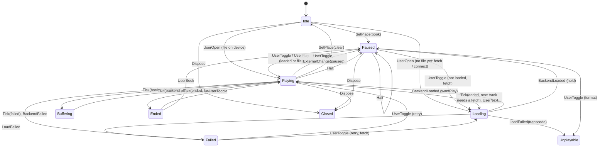

<!-- SPDX-FileCopyrightText: 2026 Joerg Bernau <Joerg@bernau.family> -->
<!-- SPDX-License-Identifier: AGPL-3.0-or-later -->
# The player state machine

Project owner, 2026-10-30: "PlayerEngine <= State machine", "das gilt ebenso für Radio und Podcasts". The playback engine is an explicit finite state
machine, not a bag of booleans, and the same machine serves books/albums/playlists, podcast episodes and radio stations.

Code: `app/lib/player/state_machine.dart` (the pure function), `app/lib/player/engine.dart` (the shell), `app/lib/player/transport.dart` (messages and
transports). Tests: `app/test/player_state_machine_test.dart` (table of state x event, all three kinds), `app/test/player_transport_test.dart`
(serialization round trip).

## Layers

```
UI widgets -- PlayerController (facade, ChangeNotifier, same public API; mirrors the last snapshot)
                |  PlayerCommand (plain data)          ^ PlayerEvent: PlayerSnapshot(seq) / PositionTick / TrackHeard / ProgressQueued /
                v                                      |   LastWritten / PlaylistPosition / PodcastState / TrackFinished
          PlayerTransport  (InProcessTransport: synchronous; roundTrip: true sends everything through JSON)
                |
          PlayerEngine (shell: timer, AudioBackend, MediaSource)  --feeds-->  transition(EngineState, EngineEvent) -> (EngineState, [Effect])
```

`transition` is pure: no I/O, no timer, no clock (the time arrives as `EngineEvent.nowMs`), no backend call. What the world has to do comes back as
`Effect` values; the shell executes them in order. A backend call that throws stops the list and re-enters the machine as `BackendFailed`.

## States (closed set, sealed class)

| State | Old flags | Clock | Meaning |
|---|---|---|---|
| `Idle` | no book | stopped | nothing open |
| `Paused` | book, `playing=false`, no error | stopped | ready |
| `Loading(wantPlay, reason)` | `loading=true` (playing as wished) | runs, ticks ignored | file being fetched / station connecting |
| `Playing` | `playing=true`, loaded | runs | sound |
| `Buffering` | `playing=true`, backend `buffering` | runs | underrun, goes on by itself |
| `Ended` | `playing=false` at the end of the last track | stopped | |
| `Failed(message, kind)` | `error != null`, `playing=false` | stopped | `kind` is `AudioErrorKind`: generic, streamUnsupported, streamConnection, streamServer, streamCertificate |
| `Unplayable(index)` | `unplayable != null`, `playing=false` | stopped | format not playable here, or the server could not transcode |
| `Closed` | disposed | stopped | every event is ignored |

Combinations that cannot occur are unrepresentable: playing together with an error or unplayable; loading while idle.
The facade getters are derived from the state: `playing = Playing | Buffering | Loading(wantPlay)`, `loading = Loading`, `error = Failed.message`.

Differences to the old flags, on purpose: a failed seek or speed change is `Failed` (before: only `error` set, still "playing"); `Halt` and a fresh fetch clear a stale
`error`/`unplayable`; a fetch that was overtaken by another track no longer leaves `loading` set; `Buffering` is new (the UI still sees `playing`).

## Media kinds

`mediaKindOf(book, track)`: `live` (book kind `radio` or `track.live`), `episode` (book `ep:<id>` of kind `podcast`), else `track`. The kind decides inside the machine:

| | track | episode | live |
|---|---|---|---|
| seek, skip, next by time | yes | yes | **no-op** (same state, no effects) |
| progress to the server | `SaveProgress` (part id) | `SaveProgress` + `NoteEpisodeState` (list of downloaded episodes) | never |
| offline | `QueueProgress` (item, part) | `QueueProgress` (episode id) | never |
| heard marks, prefetch of the next | yes | n/a (one track) | no |
| end | `TrackEnded`, next track or `Ended` | `TrackEnded`, `Ended` | only `Failed` |
| stream title / details | - | - | in `Tick` -> core -> snapshot |

## Diagram (all kinds)



Live (radio): `Idle -> Loading(connect) -> Playing <-> Buffering`, `-> Failed(kind)`; `UserSeek/UserSkip/UserNext` are no-ops in every live state.
Episode: like a track with one track; `Playing -> Ended` on the end, with `NoteEpisodeState(finished)`.

## Transition table (summary; the exact rows are in the test)

| Event | Idle | Paused | Loading | Playing / Buffering | Ended | Failed | Unplayable | Closed |
|---|---|---|---|---|---|---|---|---|
| UserOpen | open (Loading/Playing/Unplayable) | same | same | same (reports the old place first) | same | same | same | ignored |
| UserToggle | ignored | play (sync) | flips `wantPlay` and fetches again | pause (reports first) | play | retry | retry (Unplayable again if still) | ignored |
| UserPlay | ignored | play | if not wanted | ignored | play | retry | retry | ignored |
| UserSeek | ignored | place + `SeekBackend` if loaded | place only | place + `SeekBackend` (live: ignored) | -> Paused | place | place | ignored |
| UserSkip / Next / Previous / SelectTrack | ignored | sync | sync | sync (live: Skip/Next ignored) | sync | sync | sync | ignored |
| SetSpeed | speed | speed + `SetBackendSpeed` | same | same | same | same | same | ignored |
| Tick | ignored | ignored | ignored | position, heard, report, prefetch, end/failed/buffering | ignored | ignored | ignored | ignored |
| ExternalChange | ignored | paused/playing by the system | ignored | same | | | | ignored |
| BackendLoaded(key) | ignored | ignored | -> Playing/Paused (key must match) | ignored | ignored | ignored | ignored | ignored |
| LoadFailed(key) | ignored | ignored | -> Failed / Unplayable (key must match) | ignored | ignored | ignored | ignored | ignored |
| BackendFailed | ignored | Failed | Failed | Failed | Failed | Failed | Failed | ignored |
| SetPlace | Paused / Idle | place | place | place | place | place | place | ignored |
| Halt | Idle | Paused | Paused | Paused | Paused | Paused | Paused | ignored |
| Flush / ClearHeard / EnvChanged / PrefetchFailed | data only | | | | | | | ignored |
| Dispose | Closed | Closed | Closed | Closed | Closed | Closed | Closed | ignored |

"Ignored" means: the same state object and no effects (an explicit, tested no-op).

## Effects

`LoadTrack`, `FetchAndLoad`, `StartPlayback`, `PausePlayback`, `SeekBackend`, `StopBackend`, `DisposeBackend`, `EnsureSpeed`, `SetBackendSpeed`, `StartTick`, `StopTick`,
`WriteLast`, `SaveProgress`, `QueueProgress`, `NoteEpisodeState`, `MarkHeard`, `TrackEnded`, `PrefetchNext`, `EmitSnapshot`, `EmitPosition`.
A tick that changes nothing coarse ends in `EmitPosition` (a `PositionTick`), else in `EmitSnapshot`.

## Next machines (STAGE C, not done)

1. **The radio connection** `RadioStreamSession` (`app/lib/audio/radio_stream.dart`, the isolate wrapper `radio_isolate.dart`): Connecting, Streaming, Backoff
   (reconnect delay), Fatal, Closed; events: connected, bytes, closed by the peer, timeout, `close()`. Implicit state today: `_closed` (radio_stream.dart),
   the `failures` counter against `reconnectAttempts`/`reconnectDelay`, and `_started`, `_closed`, `_exited`, `_failReceived` in radio_isolate.dart.
2. **The podcast download and episode lifecycle** and the list controllers. `app/lib/podcast_downloads.dart`: NotDownloaded -> Downloading(progress) -> Downloaded | Failed;
   implicit in the maps `_entries` (downloaded), `_progress` (downloading, `isDownloading`), `_tokens`/`CancelToken._cancelled` (cancel), `EpisodeDownloadException`.
   `PodcastsController` (`app/lib/screens/podcasts_screen.dart`: `podcasts` null = loading, `error` string, `api == null` = no server, `_disposed`), the
   episode list in the same file (`_episodes`, `_failed`), and `RadioController` (`app/lib/screens/radio_screen.dart`: same pattern, `error`, `_disposed`):
   Loading, Loaded, Empty, Error, Offline.
