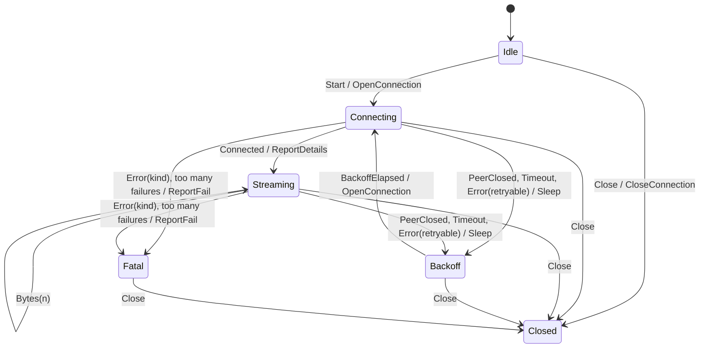
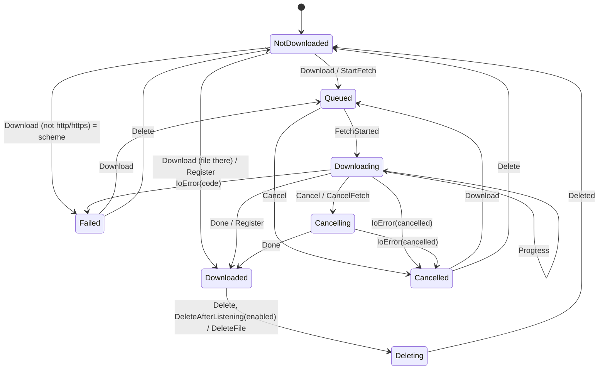
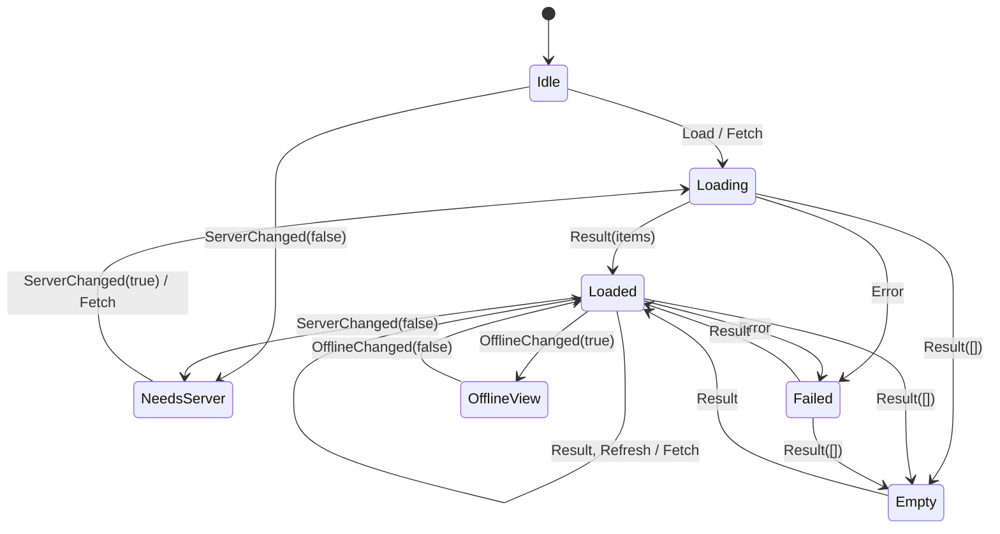

# State machines of stage C: radio connection, podcast download, list loading

Same style as `spec-player-state-machine.md`: sealed states, sealed events, a pure `transition` function, effects as data, a thin shell that carries them out.
"Ignored" means: the same state object and no effects (explicit, tested no-op). Tests: `app/test/radio_connection_machine_test.dart`,
`podcast_download_machine_test.dart`, `list_machine_test.dart`.

## 1. Radio connection (`app/lib/audio/radio_connection_machine.dart`)

Shell: `RadioStreamSession._run` (`radio_stream.dart`). The numbers (delay, attempts, healthy bytes) come in as a `RadioPolicy`.

| Event | Idle | Connecting(f) | Streaming(f, delivered) | Backoff(a) | Fatal | Closed |
|---|---|---|---|---|---|---|
| Start | Connecting(0) + OpenConnection | ignored | ignored | ignored | ignored | ignored |
| Connected | ignored | Streaming(f, 0) + ReportDetails | ignored | ignored | ignored | ignored |
| Bytes(n) | ignored | ignored | delivered += n | ignored | ignored | ignored |
| PeerClosed / Timeout / Error(no kind) | ignored | lost | lost | ignored | ignored | ignored |
| Error(kind) | ignored | Fatal + ReportFail | Fatal + ReportFail | ignored | ignored | ignored |
| BackoffElapsed | ignored | ignored | ignored | Connecting(a) + OpenConnection | ignored | ignored |
| Close | Closed + CloseConnection | same | same | same | same | ignored |

"lost": `n = (delivered >= healthyBytes ? 0 : f) + 1`; `n > reconnectAttempts` -> Fatal(streamConnection, "connection lost: <reason>") + ReportFail, else Backoff(n) + Sleep(delay).
Effects: `OpenConnection`, `Sleep(delay)`, `ReportDetails`, `ReportFail(message, kind)`, `CloseConnection`. `_closed` and `_delivered` of the old loop are gone; the shell asks `state is RadioClosed`.
The headers themselves (`StreamDetails`) are held by the shell; the machine only orders `ReportDetails`.

## 2. Podcast download (`app/lib/podcasts/download_machine.dart`)

Per episode. Shell: `PodcastDownloads` (`podcast_downloads.dart`), `_states` replaces the map `_progress`; `_entries` is the data of the `Downloaded` ones;
`_tokens` is the resource behind `CancelFetch`. UI: `EpisodeDownloadButton` switches over `stateOf(id)`.
The cleanup of `.part` files at start runs once before any episode has a state (all are `NotDownloaded`), so it is no event.

| Event | NotDownloaded | Queued | Downloading | Cancelling | Downloaded | Failed / Cancelled | Deleting |
|---|---|---|---|---|---|---|---|
| Download | Queued / Downloaded / Failed(scheme) | ignored | ignored | ignored | Register (file there) or Queued (file gone) | like NotDownloaded | ignored |
| Cancel | ignored | Cancelled | Cancelling | ignored | ignored | ignored | ignored |
| Delete | ignored | ignored | ignored | ignored | Deleting | NotDownloaded | ignored |
| DeleteAfterListening | ignored | ignored | ignored | ignored | Deleting if enabled | ignored | ignored |
| FetchStarted | ignored | Downloading | ignored | ignored | ignored | ignored | ignored |
| Progress | ignored | ignored | Downloading | Cancelling | ignored | ignored | ignored |
| Done | ignored | Downloaded | Downloaded | Downloaded | ignored | ignored | ignored |
| IoError | ignored | Failed / Cancelled | Failed / Cancelled | Failed / Cancelled | ignored | ignored | ignored |
| Deleted | ignored | ignored | ignored | ignored | ignored | ignored | NotDownloaded |
| FileFound / FileGone (data only) | Downloaded / ignored | ignored | ignored | ignored | ignored / NotDownloaded | FileFound -> Downloaded | FileGone -> NotDownloaded |

Effects: `StartFetch`, `CancelFetch`, `Register`, `DeleteFile`, `Notify(force)` (progress is throttled by `force: false`).
`isDownloading` = Queued, Downloading or Cancelling; `progressOf` is derived from the state.

## 3. List loading (`app/lib/lists/list_machine.dart`)

One generic machine `ListState<T>` for `PodcastsController` and `RadioController` (both extend the shell `lists/list_controller.dart`). The `Body` widgets switch
over `controller.state`. `ListOfflineView(under)` wraps any state: the answers still reach `under`, and `OfflineChanged(false)` shows it again. The podcast
widgets report the offline scope with `controller.noteOffline(...)` from `build` (silent, never notifies); the radio list has no offline view.

| Event | Idle | Loading / Loaded / Empty / Failed | NeedsServer | OfflineView(under) |
|---|---|---|---|---|
| Load | Loading + Fetch | ignored | ignored | passed to `under` |
| Refresh | ignored | same state + Fetch (what is shown stays until the answer) | ignored | passed to `under` |
| Result(items) | ignored | Loaded / Empty | ignored | passed to `under` |
| Error(code) | ignored | Failed | ignored | passed to `under` |
| ServerChanged(false) | NeedsServer | NeedsServer | ignored | passed to `under` |
| ServerChanged(true) | ignored | ignored | Loading + Fetch | passed to `under` |
| OfflineChanged(true) | OfflineView | OfflineView | OfflineView | ignored |
| OfflineChanged(false) | ignored | ignored | ignored | `under` |

Effect: `ListFetch`. Precedence in the widget is the one of the old `build`: offline view, no server, error, loading, empty, list.

## 4. CD job (server, `server/src/cdflow.rs`; 2026-10-31)

Not an app machine: the state of a CD job is stored in the database (`cd_job.cd_state`) and the apps and pages only show it. One function, `Store::cd_move(job, move, actor)`, checks that the move leads out of the state, who may make it and that nobody decided first (`invalid_move`, `forbidden`, `decided`). The table of moves and the states: `spec-cd-import-api.md` ("States of a job"); the rights: `spec-cd-inbox.md`. A test (`cdflow::tests::the_table_of_moves_is_exactly_the_flow_of_the_spec`) checks every state against every move.

The inbox is no machine of its own: an item of the inbox (`inbox_item`) is *open* or *resolved* (`resolved_at`), and a task is resolved by the event that `cd_move` makes (approve, reject, expire) through `inbox::handle`, never by a route of its own; the read mark of a notice is per person and has no states beyond read / unread.
